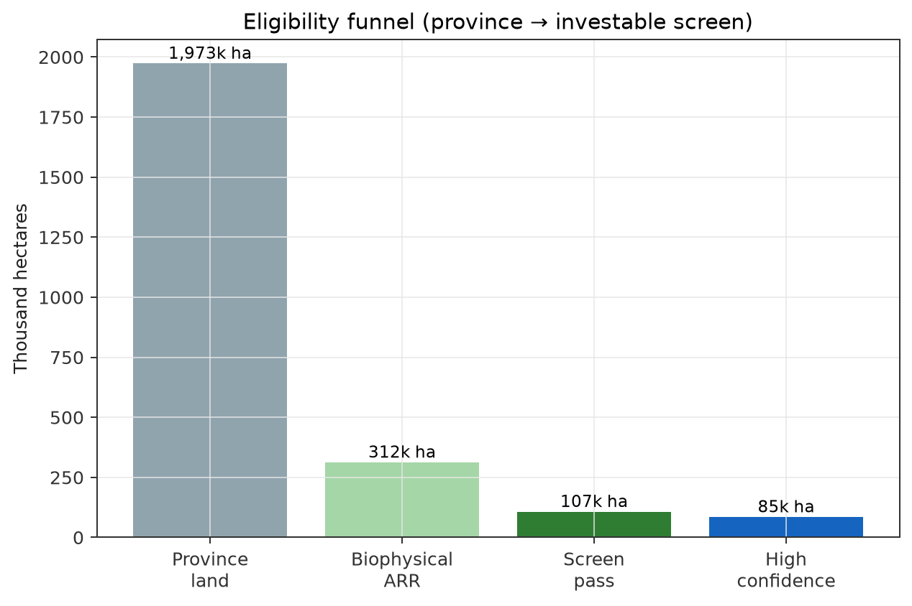
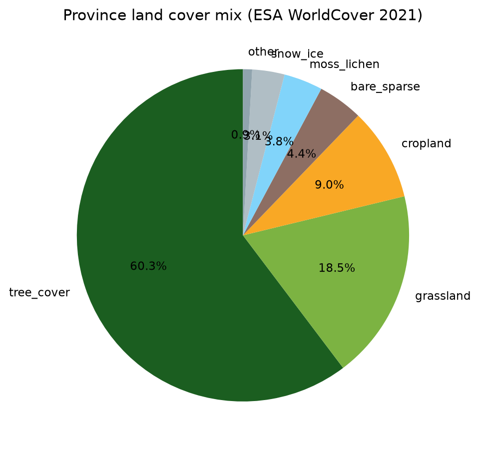
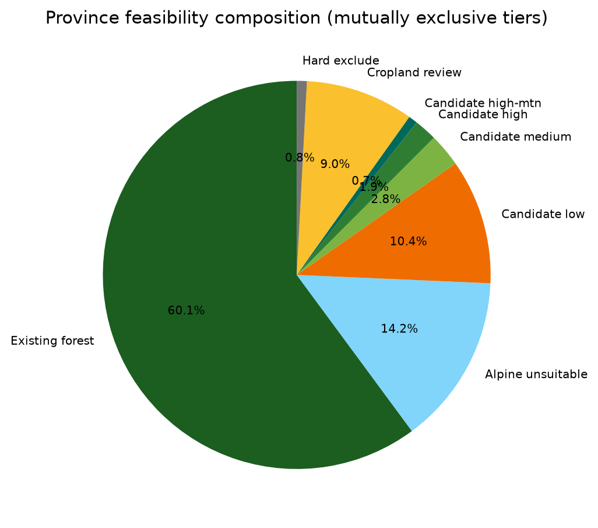
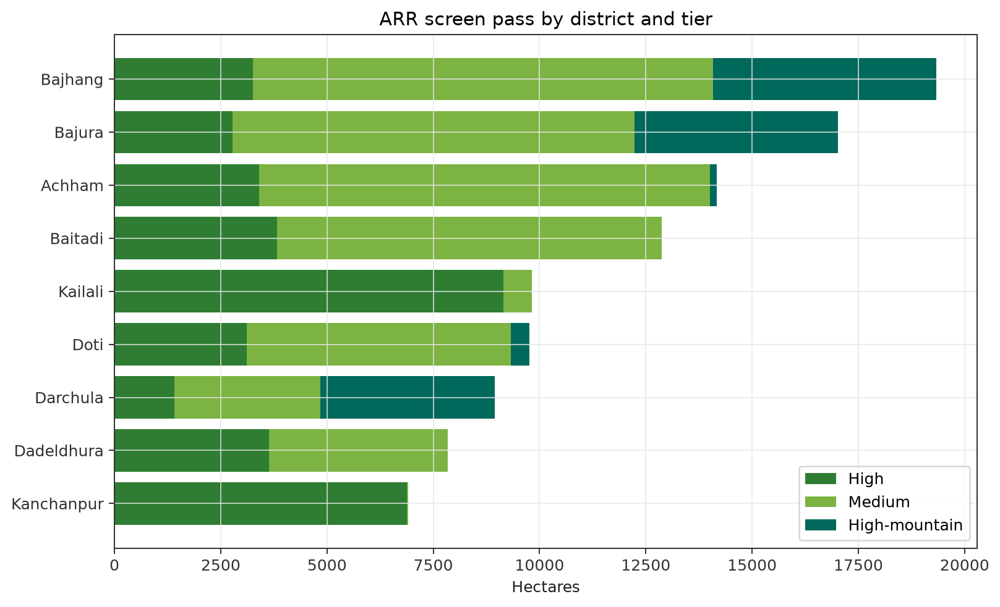
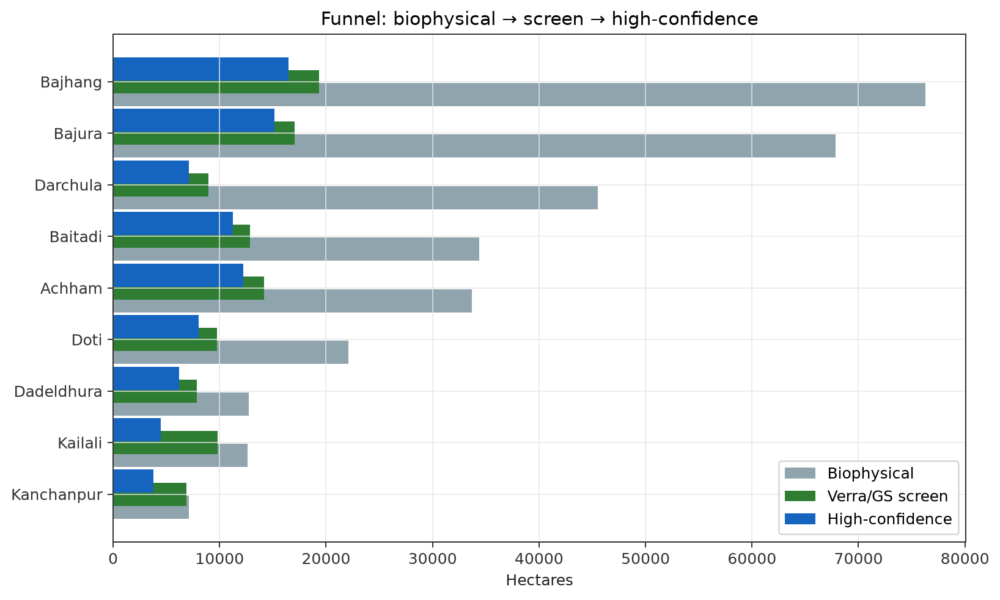
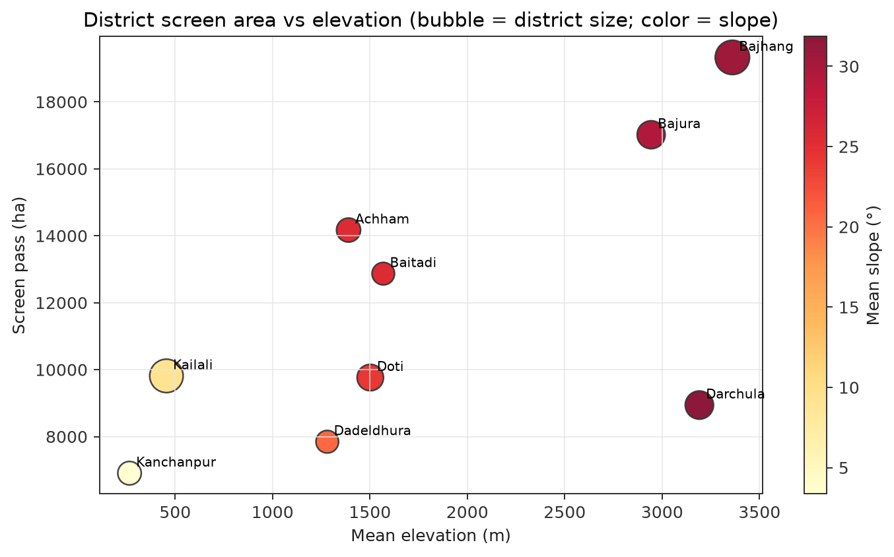
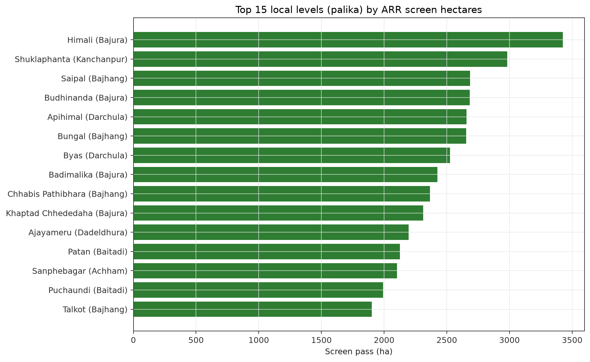
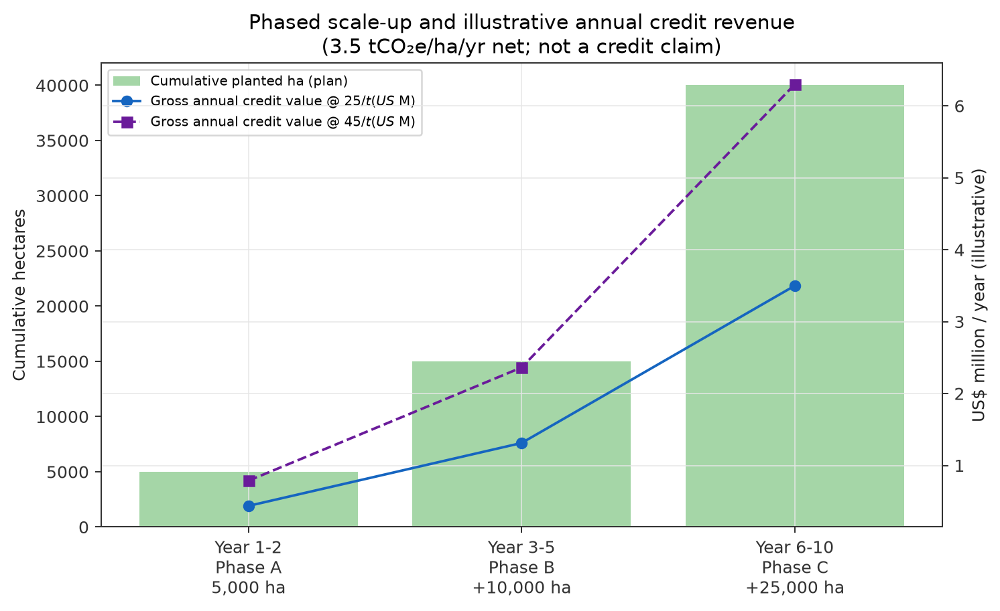
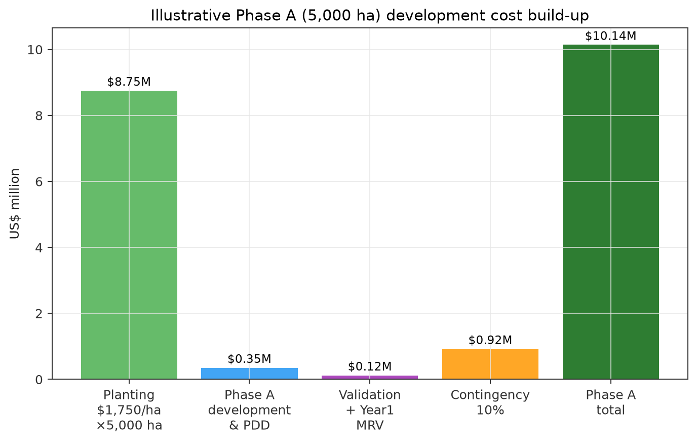

# Sudurpashchim ARR Carbon Project — Investor Brief

**Confidential — for qualified project investors and offtake partners**  
**Geography:** Sudurpashchim Province, Nepal  
**Activity class:** Afforestation, Reforestation & Revegetation (ARR)  
**Screen vintage:** Phase 1 primary desk screen v1.1 (November 2026)  
**Standards tagged:** Verra VM0047-like · Gold Standard-like · biophysical  

---

## 1. Investment thesis

Sudurpashchim offers a **province-scale ARR pipeline** with clear geographic concentration in the mid-hill districts, national policy alignment (REDD+, community forestry, FAO ReFaME in Baitadi–Darchula–Doti), and rising buyer demand for high-integrity ARR under VM0047 / CCP-aligned methodologies.

Phase 1 satellite screening of **100% of the province** (~1.97 million ha) identifies:

| Metric | Hectares |
| --- | ---: |
| Province area screened | 1,972,892 |
| Verra / Gold Standard screen (high + medium + high-mountain) | **106,658** |
| High-confidence subset (WorldCover × ESRI/IO agree) | **84,680** |
| Highest-quality tier only (gentle slope, &lt;3,000 m) | **37,450** |

**Investor takeaway:** Start with a **5,000 ha Phase A** inside the high-confidence / high-tier envelope, then scale toward **15,000–40,000 ha** as tenure, FPIC, and protected-area clearance unlock inventory.

> This document is a **feasibility and investment planning brief**, not a Verra/Gold Standard credit claim, PDD, or offer to sell securities.

---

## 2. Opportunity snapshot

### Why Sudurpashchim

- **Scale:** ~2 M ha province; nine districts; 93 local governments (palika).
- **Forest context:** Large existing forest base (~60% WorldCover tree cover in this screen; FRTC reports ~51% forest) with substantial grassland / bare mosaics suitable for ARR triage.
- **Policy tailwinds:** Nepal–South Pole J-REDD interest across Sudurpashchim; FAO/GEF ReFaME restoration corridor; dense Community Forest User Group (CFUG) institutions for co-benefit delivery.
- **Integrity market:** VM0047 ARR with CCP label is attracting **premium forward pricing** versus legacy ARR spot averages.

### What Phase 1 proved

1. Wall-to-wall open-data screen at **100 m / 1 ha** using ESA WorldCover, Hansen forest-history proxy, Copernicus DEM, and OCHA **COD-AB** official boundaries.  
2. Multi-standard tagging and **distinguishable feasibility tiers**.  
3. District + palika hectare tables ready for site shortlisting.

**Reliability (desk triage):** ~75–85% when ensemble confidence = 3; district hectare planning band ±10–25% until Phase 2 field/tenure work.

---

## 3. Portfolio composition (where the hectares are)

### 3.1 Eligibility funnel

| Stage | Area |
| --- | ---: |
| Province land | 1,972,892 ha |
| Biophysical ARR (shrub / grass / bare &lt;3,800 m) | 312,263 ha |
| Screen pass (standards-tagged) | **106,658 ha** |
| High-confidence screen | **84,680 ha** |

### 3.2 Land cover mix

Dominant classes: tree cover (~60%), grassland (~18%), cropland (~9%). Cropland is **categorized for review**, not auto-included in the carbon screen.

### 3.3 Feasibility tiers (mutually exclusive)

| Tier | Meaning | Hectares |
| --- | --- | ---: |
| Candidate high | Slope &lt;15°, elev &lt;3,000 m, ~10y non-forest | 37,450 |
| Candidate medium | Slope 15–25°, elev &lt;3,000 m | 54,486 |
| Candidate high-mountain | Elev 3,000–3,800 m, slope ≤25° | 14,722 |
| Candidate low | History fail or slope 25–35° | 205,605 |
| Cropland review | Food-security / additionality review | 177,941 |
| Existing forest | ANR watch (VM0047 v1.1 pathway) | 1,186,155 |
| Alpine unsuitable | Snow/moss or elev ≥3,800 m | 279,985 |
| Hard exclude | Built / water / wetland | 16,548 |

**Screen pass for standards tagging** = high + medium + high-mountain = **106,658 ha**.

### 3.4 District concentration

| District | Screen ha | High-confidence ha | Mean elev (m) | Mean slope (°) |
| --- | ---: | ---: | ---: | ---: |
| Bajhang | 19,328 | 16,485 | 3,361 | 30.6 |
| Bajura | 17,018 | 15,165 | 2,944 | 29.5 |
| Achham | 14,170 | 12,240 | 1,390 | 25.5 |
| Baitadi | 12,868 | 11,241 | 1,569 | 25.5 |
| Kailali | 9,814 | 4,459 | 455 | 9.2 |
| Doti | 9,764 | 8,012 | 1,502 | 24.2 |
| Darchula | 8,942 | 7,123 | 3,191 | 31.9 |
| Dadeldhura | 7,847 | 6,178 | 1,281 | 20.7 |
| Kanchanpur | 6,907 | 3,777 | 266 | 3.4 |

**Priority cluster for Phase A:** Achham · Baitadi · Dadeldhura · Doti (lower alpine share, stronger mid-hill plantable mix), with selective Bajura/Bajhang parcels below the alpine line. Terai districts (Kailali/Kanchanpur) need careful cropland and **protected-area** filters (e.g. Shuklaphanta).

### 3.5 Local-level (palika) shortlist

Top screen hectares appear in Himali, Shuklaphanta*, Saipal, Budhinanda, Apihimal, Bungal, Byas, Badimalika, and others (see `outputs/local_level_top25_screen.csv`).

\* **Shuklaphanta** overlaps a national park — treat as **excluded until WDPA/legal clearance**. High-mountain palikas require species and survival diligence.

---

## 4. Standards & integrity path

| Item | Approach |
| --- | --- |
| Primary methodology | **Verra VM0047** ARR (v1.1; CCP-aligned) |
| Parallel tag | Gold Standard ARR eligibility screen (cropland not auto-passed) |
| Quantification | Area-based approach preferred at scale; census only if ≤50 trees/ha |
| Leakage | VMD0054 module; early-year leakage load modeled in cashflow |
| Permanence | Buffer pool (illustrative 10–25%); 40-year monitoring horizon |
| Co-benefits | Community forestry livelihoods, watershed, biodiversity (CCB/SDG optional premium) |

Phase 1 does **not** replace: land title / CFUG agreements, FPIC, baseline plots, or the VM0047 dynamic performance benchmark.

---

## 5. Development plan (recommended)

### Phase A — Proof portfolio (months 0–24)

- **Area:** 5,000 ha from high + high-confidence cells in Achham, Baitadi, Dadeldhura, Doti (and cleared Bajura parcels).  
- **Work:** tenure mapping, FPIC, WDPA mask, soil/species design, nursery, planting/ANR, PDD draft, VVB validation start.  
- **Exit:** validated project design + first offtake LOI.

### Phase B — Scale (years 2–5)

- Expand to **~15,000 ha** cumulative inside screen envelope.  
- Operationalize community benefit-sharing and MRV (remote sensing + plots).

### Phase C — Province platform (years 5–10)

- Grow toward **~40,000 ha** of the 84,680 ha high-confidence pool (or deeper into the 106,658 ha screen where field confirms).  
- Optional ANR layer on degraded forest under VM0047 v1.1 (separate workstream).

---

## 6. Illustrative economics (not a forecast)

Assumptions used for investor illustration only:

| Parameter | Conservative case |
| --- | --- |
| Net removals | **3.5 tCO₂e/ha/year** (after ~15% buffer and ~15% leakage factors on ~5 t gross) |
| Credit price | Scenario A **US$25/t** · Scenario B **US$45/t** (quality ARR / forward) |
| Establishment | **US$1,500–2,000/ha** (Nepal NbS/restoration refs; site-specific) |
| Crediting | First issuance typically **year 2–4** after planting; 40-year horizon |

### Phase A cost build-up (5,000 ha)

| Cost item | Illustrative US$ |
| --- | ---: |
| Planting / establishment @ $1,750/ha | 8.75 M |
| Development, PDD, community process | 0.35 M |
| Validation + year-1 MRV | 0.12 M |
| Contingency ~10% | 0.92 M |
| **Phase A total (order of magnitude)** | **~10.1 M** |

### Illustrative annual credit value at maturity of each phase

| Cumulative ha | tCO₂e/yr (net 3.5) | @ $25/t | @ $45/t |
| ---: | ---: | ---: | ---: |
| 5,000 | 17,500 | US$0.44 M/yr | US$0.79 M/yr |
| 15,000 | 52,500 | US$1.31 M/yr | US$2.36 M/yr |
| 40,000 | 140,000 | US$3.50 M/yr | US$6.30 M/yr |

Payback depends on offtake timing, survival, leakage schedule, and buffer. VM0047 leakage front-loading can push investor break-even later than legacy ARR models — model explicitly in diligence.

**Upside levers:** CCP/VM0047 price premium; mixed-species / community co-benefit premia; lower establishment via assisted natural regeneration; stacked non-carbon finance (GEF/adaptation).

**Downside levers:** tenure failure, PA overlap, grazing/fire, cloud-affected remote sensing, offtake price compression, delayed validation.

---

## 7. Capital ask (indicative structure)

| Tranche | Use of funds | Indicative size |
| --- | --- | --- |
| Seed / development | Phase 2 diligence, FPIC, PDD, VVB | US$0.4–0.8 M |
| Phase A project finance | 5,000 ha establishment + year 1–2 ops | US$8–12 M |
| Scale facility | Phase B/C as milestones clear | US$25–70 M (staged) |

Preferred partner profile: climate fund / corporate offtaker comfortable with **nature-based removals**, multi-year forward purchase, and community-governed land in Nepal.

---

## 8. Risk register (principal items)

| Risk | Mitigation |
| --- | --- |
| Tenure / CFUG consent | Early district forest office + CFUG mapping; no planting without agreements |
| Protected areas | WDPA + provincial PA overlay before final polygons (exclude Shuklaphanta NP) |
| Over-crediting / integrity | VM0047 area-based + control plots; conservative Tier defaults until local calibration |
| Alpine / survival | Prefer &lt;3,000 m Phase A; species trials for high-mountain tier |
| Food security | Cropland excluded from auto-screen; agroforestry only with explicit design |
| Political / benefit sharing | Transparent provincial MoU; community revenue share in term sheet |
| Market price | Floor price in offtake; tranche capital to issuance milestones |

---

## 9. Data room (Phase 1 artifacts)

| Artifact | Location |
| --- | --- |
| District summary | `arr_phase1/outputs/district_summary.csv` |
| Local-level top 25 | `arr_phase1/outputs/local_level_top25_screen.csv` |
| Methods & totals | `arr_phase1/outputs/methods_and_totals.json` |
| Feasibility overview map | `arr_phase1/outputs/feasibility_overview.png` |
| Investor charts | `arr_phase1/investor/charts/` |
| Reproducible pipeline | `arr_phase1/scripts/run_phase1_screen.py` |

---

## 10. Proposed next steps (90 days)

1. **Investor soft-circle** on Phase A (5,000 ha) term sheet outline.  
2. **Phase 2 diligence sprint:** WDPA mask, CFUG/tenure sample in Achham–Baitadi–Dadeldhura–Doti, 30 m revisit, 50–100 field plots.  
3. **Species & nursery plan** with provincial forest authority.  
4. **Offtake outreach** for VM0047 forward volume (years 3–10).  
5. **Go / no-go** gate to full PDD budget.

---

## 11. Contact & disclaimer

Prepared from the Sudurpashchim ARR Phase 1 v1.1 open-data screen (November 2026, Asia/Katmandu).  

**Disclaimer:** Figures are screening estimates for investment planning. They are not verified carbon credits, audited financial projections, or an offer to sell securities. Any transaction requires independent legal, technical, and financial due diligence under Nepal law and the chosen carbon standard.

---

*Charts referenced above are in `arr_phase1/investor/charts/`. Interactive analytics: see project canvas “Sudurpashchim ARR Investor Pack”.*
